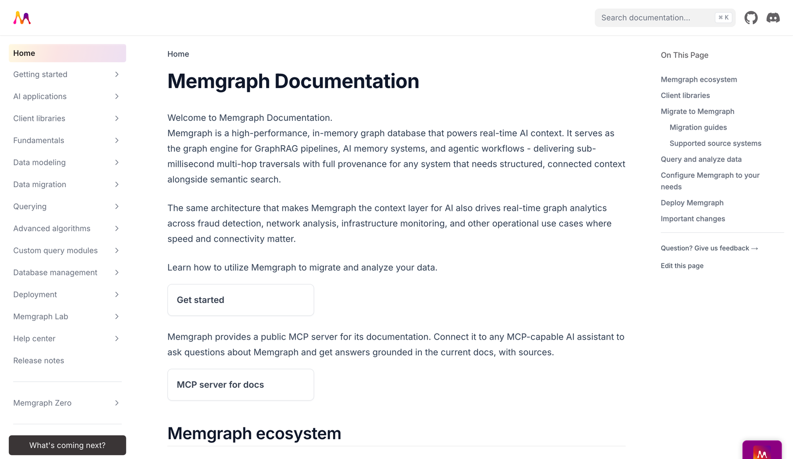

<h1 align="center"><a href="https://memgraph.com/docs/">Memgraph Documentation</a></h1>

<p align="center">
  <a href="https://memgr.ph/join-discord">
    
  </a>
</p>

<p align="center">
  <a href="https://memgraph.com/docs">
    
  </a>
</p>

This repository is the source of the Memgraph documentation at
[memgraph.com/docs](https://memgraph.com/docs). The site is built with
[Nextra](https://nextra.site/), and each page is an `.mdx` file in `pages/`.

## Run the docs locally

You need [Node.js](https://nodejs.org/en/download/) 22 and
[pnpm](https://pnpm.io/installation) 10.

```bash
git clone https://github.com/memgraph/documentation.git
cd documentation
pnpm i
pnpm dev
```

Open [http://localhost:3000/docs](http://localhost:3000/docs). The page
reloads as you edit.

To build the site as it's deployed, and serve the build:

```bash
pnpm build
pnpm start
```

The build also generates the sitemap and the `llms.txt` files.

## Check your changes

Two checks run on every pull request. You can run them before you push:

```bash
pnpm check
python3 scripts/check-examples.py --base origin/main
```

- `pnpm check` checks links, section links, redirects and the sidebar. It
  takes about a second.
- `check-examples.py` runs the Cypher examples on the pages you changed on
  Memgraph in Docker, and checks the procedure, function and flag names they
  use. It needs Docker.

## Contribute

To fix or improve a page, open a pull request to `main`. To report a problem
without fixing it, open an [issue](https://github.com/memgraph/documentation/issues).

- **How to write a page:** see [AGENTS.md](AGENTS.md). It has the rules for
  frontmatter, headings, links, images, code blocks, the sidebar and
  redirects.
- **Docs for an unreleased Memgraph version** go to that release's branch,
  `release/<version>`, not to `main`.
- **Pull request description:** fill in the [pull request
  template](.github/pull_request_template.md).

For questions, ask on [Discord](https://memgr.ph/join-discord).
